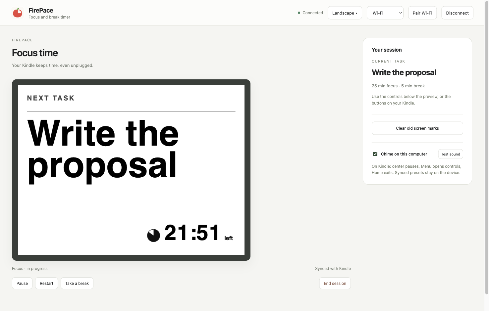
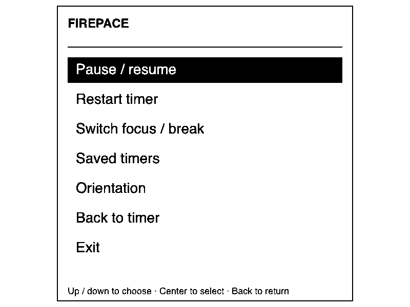
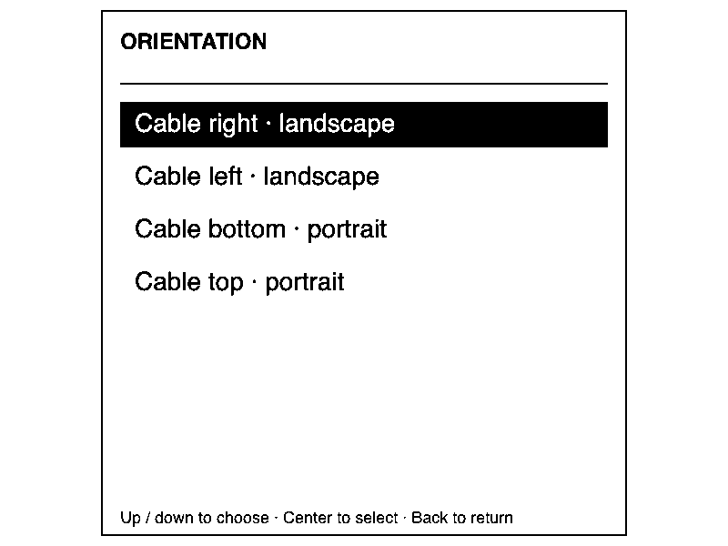

# FirePace

A focus timer that can keep running on your e-reader without the computer.

## What you need

- macOS or Linux, Python 3.9 or newer, and the `ssh` command.
- A modern browser. No JavaScript packages or build step are needed.
- A jailbroken Kindle with USBNetwork and NiLuJe's FBInk tools installed.
- For wireless use, the computer and Kindle must join the same local Wi-Fi network.

Tested hardware: silver Kindle 4 Non-Touch, firmware 4.1.4. This release uses a 600 × 800 screen. Other models need an adapter; see [Adapting the app](docs/ADAPTING.md). Windows helpers have not been tested and the current helper uses Unix terminal APIs.

## Start

1. Download or clone this repo.
2. On a Mac, open `Launch.command`. You can also run `python3 server.py --open` in this folder.
3. The page opens in your browser. Keep the helper running while you use it.

The page and helper run on your computer. There is no account, cloud service, or public server.

## Connect with USB

Enable USBNetwork on the Kindle, then connect it to the computer. Choose **USB cable** and **Connect Kindle** in the app.

The default adapter expects the usual Kindle 4 USBNetwork address. Your computer must already have a working USBNetwork connection. On first use, it trusts the host key seen over that physical USB link. Later connections check that key.

## Connect with Wi-Fi

1. Join Wi-Fi on the Kindle.
2. Connect it once with USBNetwork enabled.
3. Click **Pair Wi-Fi**. Nothing needs to be typed on the Kindle.
4. Once paired, choose **Wi-Fi**. You can remove the cable.

Pairing creates a local device key in the app's private data folder and installs its public part on your Kindle. It starts a separate, password-disabled Wi-Fi connection on port 2222. It leaves the existing USB login in place. No credentials are shown or sent to a cloud service.

If the Kindle's address changes, the helper searches the paired IPv4 subnet and checks the device's saved host key before connecting. Discovery does not scan other networks. After a Kindle reboot, open **KUAL → E-reader Wi-Fi → Start secure Wi-Fi connection**. If you move to a different network, pair over USB again.

Use only one app to control the Kindle screen at a time. Disconnect one before connecting the other.

## Choose, focus, repeat

Start a ready-made 25/5, 50/10, or 15/3 minute timer, or enter a task and make your own. Save a custom timer to use it again. Count-up mode runs without a fixed end time.

Once started, setup fields move out of the way. Use **Pause**, **Restart**, **Take a break**, or **End session**. Countdown sessions switch between focus and breaks. The task text grows or shrinks to fit the screen.

**Orientation** changes the screen layout without restarting the timer. There are four choices, one for each cable position. The same choices are available from the Kindle's menu.

## Use it without the computer

Connect before you start a session. FirePace sends the task, timer, and screen assets to the Kindle. The timer then runs on the Kindle itself, even after you disconnect, remove the cable, or close the browser.

Click **Sync saved timers to Kindle** to send the ready-made timers and your custom timers. On the Kindle, open **Menu → Saved timers**, choose one, then press the center button. This starts a new session. You can later launch the last timer from **KUAL → FirePace**.

| Kindle button | Action |
| --- | --- |
| Center | Pause or resume; choose a menu item |
| Menu | Open timer controls |
| Up/down or page buttons | Move through menu choices |
| Back | Close the menu; exit when already on the timer |
| Home | Exit FirePace |

The menu has restart, focus/break switching, saved timers, and orientation. Exiting returns control to the stock Kindle interface.

## Sound

The Kindle 4 has no speaker. **Chime on this computer** plays a short tone when the session changes. Use **Test sound** to check it. Keep the browser open for sound; the Kindle timer itself does not need the browser. Browser or system muting can silence the chime.

The app saves presets in this browser and in the local helper's `data.json`. On macOS the folder is `~/Library/Application Support/firepace`; on Linux it is `~/.local/share/firepace`. `EINK_DATA_DIR` can choose another folder.

## Screenshots

The browser screenshots use sample text. Device screenshots come directly from the Kindle framebuffer.

## Development

See [AGENTS.md](AGENTS.md) for the file map and checks. See [device tests](docs/TESTING.md) for what was checked on real hardware. The app icon was selected from AI-generated concepts. No Amazon fonts, firmware, or jailbreak files are included.
